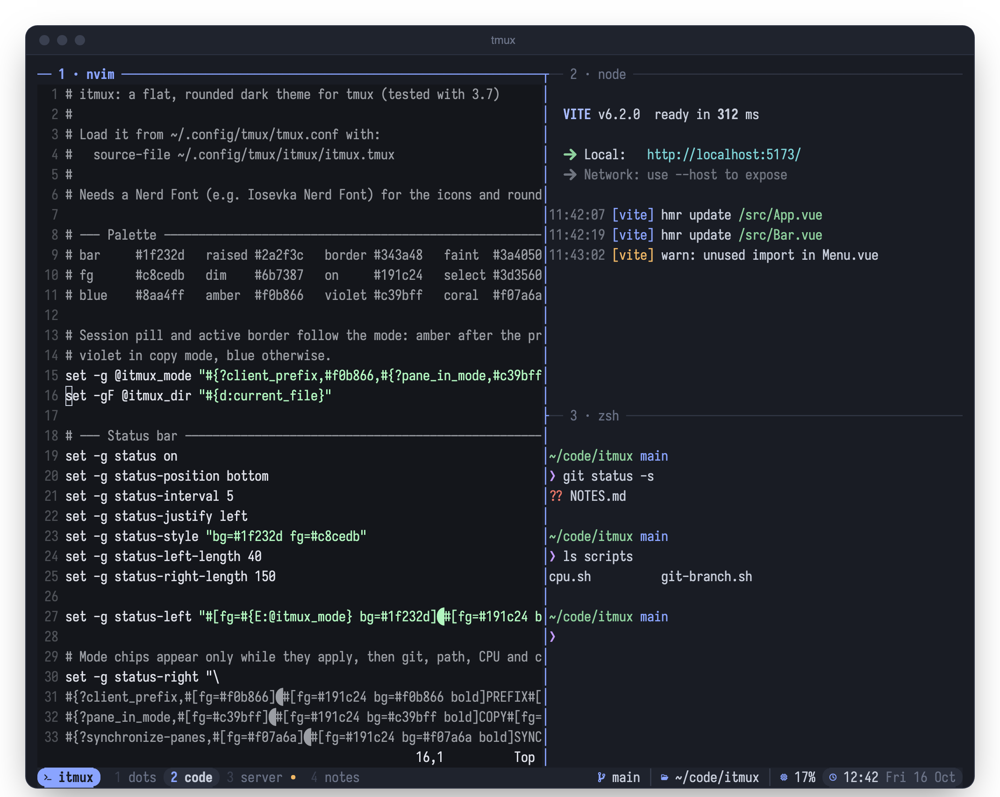
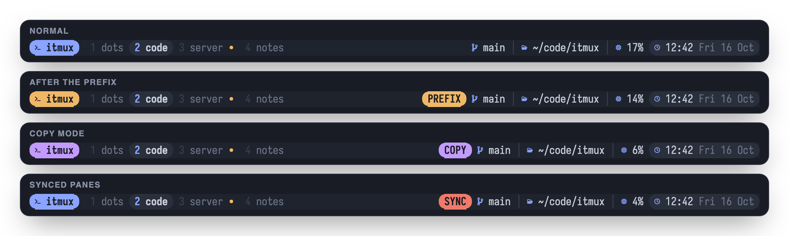
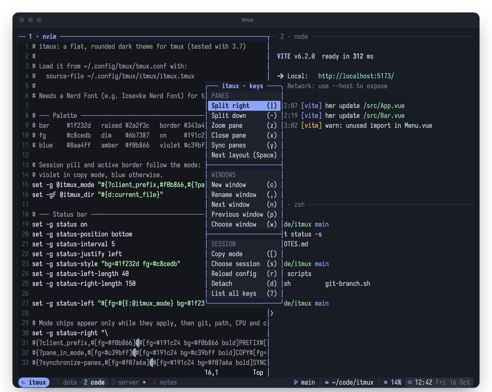

# itmux

A flat, rounded dark theme for tmux, with a key menu that lists every binding.



## Features

- **Session pill** that changes colour with the mode: blue normally, amber after the prefix, violet in copy mode.
- **Window list** with the current window highlighted. `•` marks activity in a background window and `` marks a zoomed pane.
- **Mode labels** (PREFIX, COPY, SYNC) that only appear while that mode is on.
- **Git branch** of the active pane's folder, hidden outside a repository.
- **Current folder**, with your home folder shortened to `~`.
- **CPU usage** across all cores. It turns amber at 50% and coral at 80%.
- **Clock** with the date.
- **Pane titles** on each pane's top border. The active pane's border uses the mode colour, and all borders turn coral while panes are synced.
- **Key menu** on `prefix` + `Space`.

The session pill and a label on the right change with the mode:



## Requirements

- tmux 3.7 (the version it was tested with; earlier 3.x versions may work)
- A [Nerd Font](https://www.nerdfonts.com) set as your terminal font, for the icons and rounded edges
- `git`, for the branch segment

## Installation

1. Put this folder in your tmux config folder, at `~/.config/tmux/itmux`:

   ```sh
   git clone <repo-url> ~/.config/tmux/itmux
   ```

   Or copy the folder there. The theme finds its `scripts/` folder relative to `itmux.tmux`, so another location also works if you change the paths below to match.

2. Make sure the scripts can run:

   ```sh
   chmod +x ~/.config/tmux/itmux/scripts/*.sh
   ```

3. Add this line to your tmux config, `~/.config/tmux/tmux.conf`:

   ```tmux
   source-file ~/.config/tmux/itmux/itmux.tmux
   ```

   If you use TPM, put it above the `run '~/.tmux/plugins/tpm/tpm'` line.

4. Remove or comment out any other theme, such as `catppuccin/tmux` or `tmux-dotbar`. Theme plugins set the same options and will override each other.

5. Reload tmux:

   ```sh
   tmux source-file ~/.config/tmux/tmux.conf
   ```

   If parts of an old theme are still visible, restart tmux with `tmux kill-server`. This closes all sessions.

## Key menu

Press `prefix` then `Space` to open the menu. Press an item's key to run it, or `Esc` to close.



| Group   | Action          | Key     |
| ------- | --------------- | ------- |
| Panes   | Split right     | `\|`    |
|         | Split down      | `-`     |
|         | Zoom pane       | `z`     |
|         | Close pane      | `x`     |
|         | Sync panes      | `y`     |
|         | Next layout     | `Space` |
| Windows | New window      | `c`     |
|         | Rename window   | `,`     |
|         | Next window     | `n`     |
|         | Previous window | `p`     |
|         | Choose window   | `w`     |
| Session | Copy mode       | `[`     |
|         | Choose session  | `s`     |
|         | Reload config   | `r`     |
|         | Detach          | `d`     |
|         | List all keys   | `?`     |

The menu takes over `prefix` + `Space`, which tmux uses by default to cycle pane layouts. Layout cycling is in the menu instead: press `Space` twice.

The menu runs these actions itself, so they work even if you haven't bound the same keys in your own config. *Reload config* reloads `~/.config/tmux/tmux.conf`. If your config is somewhere else, change that path in `itmux.tmux`.

## Customising

All colours are hex values in `itmux.tmux`, and the palette is listed at the top of the file. To change one, replace that hex value everywhere it appears in the file and in `scripts/`.

To remove a status bar segment, delete its line from `status-right` in `itmux.tmux`.

## Uninstalling

Remove the `source-file ~/.config/tmux/itmux/itmux.tmux` line from your tmux config, delete `~/.config/tmux/itmux`, then restart tmux with `tmux kill-server`.

## Files

| File                    | Purpose                                          |
| ----------------------- | ------------------------------------------------ |
| `itmux.tmux`            | The theme and the key menu                       |
| `scripts/git-branch.sh` | Prints the git branch, or nothing outside a repo |
| `scripts/cpu.sh`        | Prints CPU usage with a colour for the load      |
